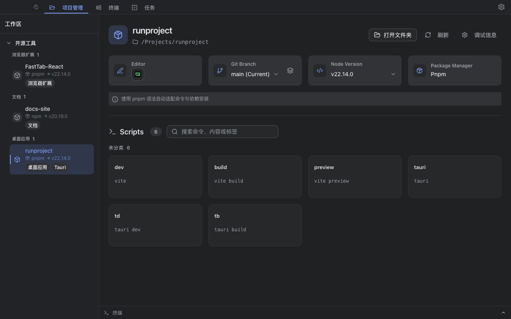
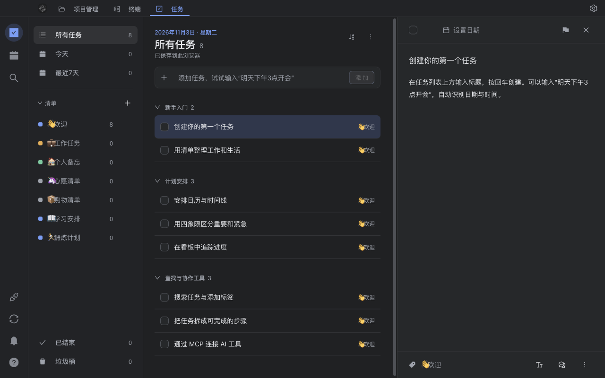

# RunProject

[简体中文](README.md) | **English**

RunProject is a desktop workspace for developers who work across multiple projects. It brings projects, package scripts, Node.js environments, terminals, and tasks into one place, making it easier to switch between frontend and Node.js projects.

## Screenshots

Browse workspaces, inspect project scripts, and choose a project environment. This screenshot uses a sample workspace.

View task management

Organize tasks with lists, groups, and a detail panel. The screenshot shows the built-in onboarding tasks.

## Features

| Feature | What you can do |
| --- | --- |
| Workspaces and projects | Scan directories for projects, organize them with tags, and find them with keywords or `#tags` |
| Package scripts | Run, stop, or restart scripts from `package.json`, and inspect their status and logs |
| Node.js environments | Use NVM / FNM integration to choose a Node.js version and package manager for each project |
| Built-in terminal | Open a terminal panel within the project page, use multiple sessions, or switch to the dedicated terminal page |
| Git and editors | View and switch Git branches, and open a project in an editor or file manager |
| Task management | Plan work with lists, tags, subtasks, a calendar, a kanban board, and an importance/urgency matrix |
| MCP integration | Access local project, task, and script management from compatible MCP clients |
| Agent manager | Choose a coordinator model and reasoning effort, connect an OpenAI-compatible API, and delegate Codex workers |
| Appearance | Choose a light or dark theme |

## Download and install

Visit [GitHub Releases](https://github.com/black-lattice/runproject/releases/latest) and choose a package for your system.

| Platform | Package |
| --- | --- |
| macOS Apple Silicon | DMG with `aarch64` in the filename |
| macOS Intel | DMG with `darwin_x64` in the filename |
| Windows 64-bit | EXE installer |
| Linux 64-bit | AppImage or DEB |

RunProject v0.1.11 and later require macOS 12 or newer on Mac. You can check for updates under Settings → About or let Sparkle check periodically. For a first install or an upgrade from v0.1.10 or earlier, download the DMG for your Mac.

macOS may show a security prompt for builds without Apple notarization. After verifying the source, allow the app in System Settings → Privacy & Security.

Running project scripts requires the appropriate Node.js environment and package manager on your computer. Configure NVM or FNM to switch Node.js versions per project.

## Get started

1. Open Project Management (项目管理) and select Add Workspace (添加工作区) to choose a directory containing your projects.
2. Select a project in the sidebar to see its scripts, Node.js version, package manager, and Git information.
3. Choose the required Node.js version and use a script's run button to start it.
4. Inspect status and logs in the run overview, stop or restart scripts as needed, and expand the terminal panel for further terminal work.
5. Add tags to workspaces, projects, and scripts to make them easier to find.
6. After editing `package.json`, use Refresh (刷新) in the project details to reload its information.

On the project management page, press `⌘/Ctrl + K` to search projects and commands, or `⌘/Ctrl + Shift + O` to add a workspace.

Workspaces import direct child folders, preserving folder names and non-Node projects. Selecting a directory with its own project manifest imports that project itself. To manage a project deeper in the directory tree, add its directory as a separate workspace. Node package names remain available as metadata.

## Organize tasks

Open Tasks (任务) from the top navigation. Create lists for work or personal activities, and add dates, tags, notes, and subtasks. Use the calendar to plan time, the kanban board to track progress, and the matrix to distinguish important and urgent work.

In-app reminders require the application to remain running. No system notifications are sent after the app has fully quit.

## Use the agent manager

Install Codex CLI and run `codex login` on the same machine. Open Manager (总管) → Connection Settings (连接设置) to detect `codex` or select its executable. RunProject starts a local app-server, routes requests to project workers, and collects their results. Task cards let you inspect progress, continue the same conversation, or interrupt work.

The model button opens independent coordinator settings: choose a Codex model and reasoning effort, or enter an OpenAI-compatible API endpoint, API key, and model ID. Keys are stored in the operating system credential store. Worker settings remain separate.

Projects come from saved workspaces or individually added directories. Task records and conversation IDs persist locally. Follow-up processing ends when the app quits; remote-machine connections are not implemented in this version. See the [agent manager guide](docs/AGENT_MANAGER.md) (in Chinese).

## Connect an MCP client

Keep the desktop app running, then open Settings → MCP Service (设置 → MCP 服务) to check the service status and copy the connection configuration. Compatible clients can manage lists, tasks, workspaces, and project scripts.

See the [MCP guide](docs/MCP.md) for configuration and tool details (in Chinese). Keep connection tokens private and out of public repositories and screenshots.

## Usage notes

- “Running” means that the process is alive. Check its logs to determine whether a service is ready.
- Script run records last for the current app session. External Kitty sessions are not included in the run overview.
- Hiding the terminal panel keeps sessions alive. Closing a session ends its process; ended sessions do not restart automatically.
- Scripts execute in local project directories. Their behavior is defined by each project's `package.json`.

## Feedback

Report problems or suggest features through [GitHub Issues](https://github.com/black-lattice/runproject/issues).
