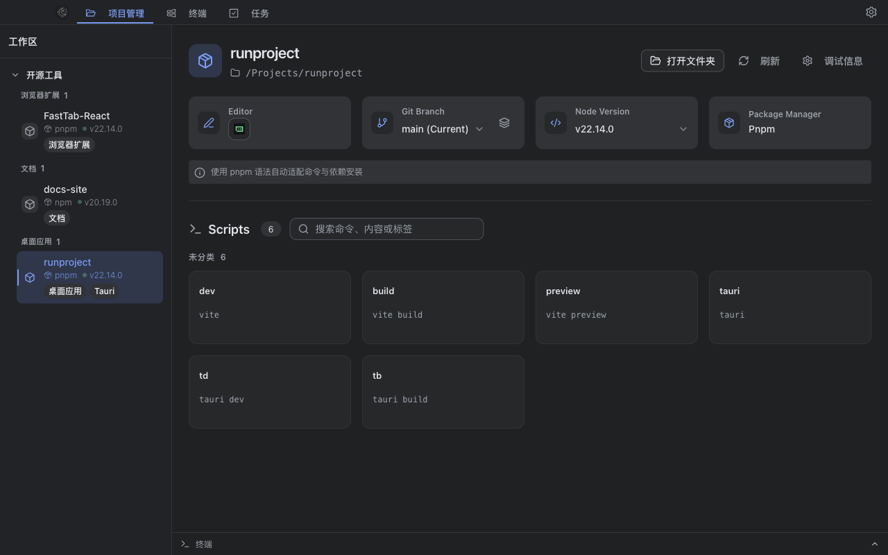
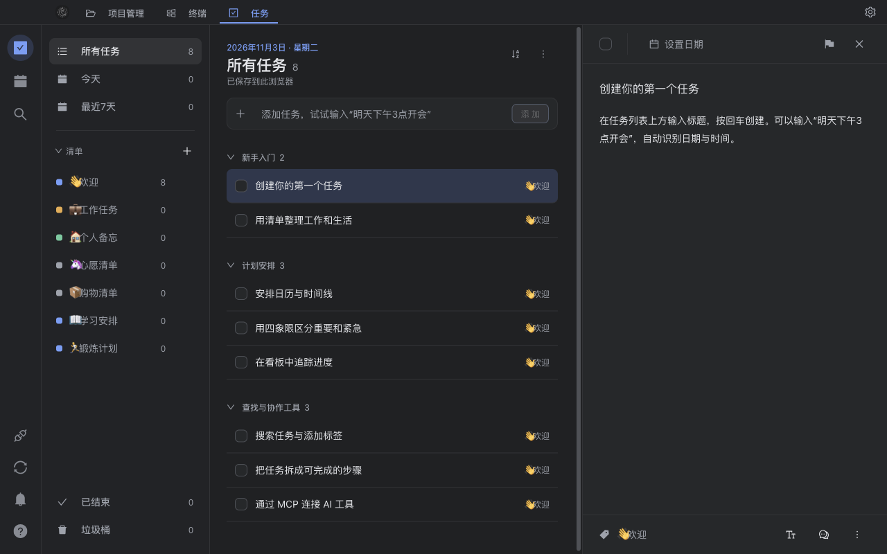

# RunProject

**简体中文** | [English](README.en.md)

RunProject 是面向多项目开发的桌面工作台，把项目、脚本、Node.js 环境、终端和待办事项集中在一个应用中。适合需要在多个前端或 Node.js 项目之间切换的开发者。

## 界面预览

浏览工作区、查看项目脚本，并选择项目使用的环境。下图使用示例工作区展示界面。

查看任务管理界面

使用清单、分组和详情面板整理待办事项，下图展示内置的新手引导任务。

## 核心功能

| 功能 | 可以做什么 |
| --- | --- |
| 工作区与项目 | 扫描目录识别项目，用标签分类，并按关键词或 `#标签` 查找 |
| 脚本运行 | 读取 `package.json` 中的 scripts，点击运行、停止或重启，查看状态与日志 |
| Node.js 环境 | 集成 NVM / FNM，为不同项目选择 Node.js 版本和包管理器 |
| 内置终端 | 在项目页展开终端面板，使用多个会话，也可进入独立终端页 |
| Git 与编辑器 | 查看和切换 Git 分支，从项目详情打开编辑器或项目目录 |
| 任务管理 | 通过清单、标签、子任务、日历、看板和四象限安排工作 |
| MCP 集成 | 让支持 MCP 的客户端访问本地项目、任务与脚本管理能力 |
| 外观 | 支持亮色与暗色主题 |

## 下载与安装

前往 [GitHub Releases](https://github.com/black-lattice/runproject/releases/latest)，选择适合当前系统的安装包。

| 系统 | 安装包 |
| --- | --- |
| macOS Apple Silicon | 文件名包含 `aarch64` 的 DMG |
| macOS Intel | 文件名包含 `x86_64` 的 DMG |
| Windows 64 位 | EXE 安装程序 |
| Linux 64 位 | AppImage 或 DEB |

macOS 未公证的安装包可能出现安全提示。确认来源后，可在「系统设置 → 隐私与安全性」中允许打开。

运行项目脚本需要本机已安装相应的 Node.js 环境与包管理器；按项目切换版本时，还需配置 NVM 或 FNM。

## 开始使用

1. 打开应用，进入「项目管理」，点击「添加工作区」选择项目所在目录。
2. 在左侧选择项目，右侧会显示脚本、Node.js 版本、包管理器和 Git 信息。
3. 根据项目需要选择 Node.js 版本，点击脚本的运行按钮启动命令。
4. 在运行概览中查看状态和日志，按需停止或重启脚本；展开底部终端面板可继续使用终端。
5. 为工作区、项目和脚本添加标签，便于日后查找。
6. 修改 `package.json` 后，点击项目详情中的「刷新」重新读取项目信息。

在项目管理页按 `⌘/Ctrl + K` 可搜索项目和命令；`⌘/Ctrl + Shift + O` 可添加工作区。

## 管理待办事项

从顶部「任务」进入任务工作台，按工作或生活场景建立清单，给任务添加日期、标签、备注和子任务。日历适合安排时间，看板适合追踪进度，四象限适合区分重要与紧急。

应用内提醒需要保持应用运行；完全退出后不会发送系统通知。

## 连接 MCP 客户端

保持桌面应用运行，在「设置 → MCP 服务」查看服务状态并复制连接配置。连接后可通过兼容的客户端管理清单、任务、工作区和项目脚本。

详细配置与工具说明见 [MCP 使用说明](docs/MCP.md)。连接令牌应保留在本机，不要放入公开仓库或截图。

## 使用须知

- 运行概览中的“运行中”表示进程仍然存活，服务是否就绪需要结合日志判断。
- 脚本运行记录只保留在本次应用运行期间；外部 Kitty 会话不纳入运行概览。
- 隐藏终端面板会保留会话，关闭会话会结束对应进程；已结束的会话不会自动重新启动。
- 脚本会在本机项目目录中执行，具体行为由项目的 `package.json` 决定。

## 反馈

遇到问题或有功能建议，欢迎提交 [Issue](https://github.com/black-lattice/runproject/issues)。
